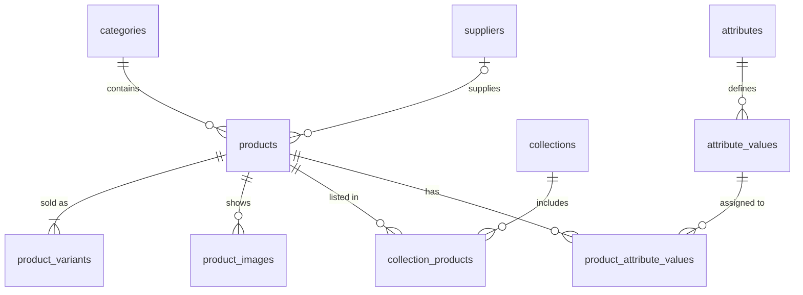
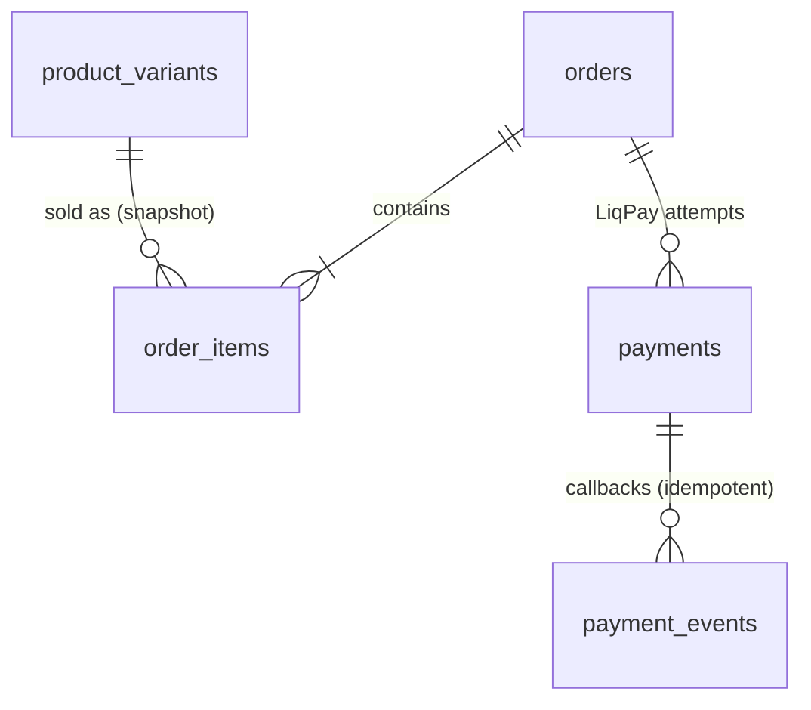
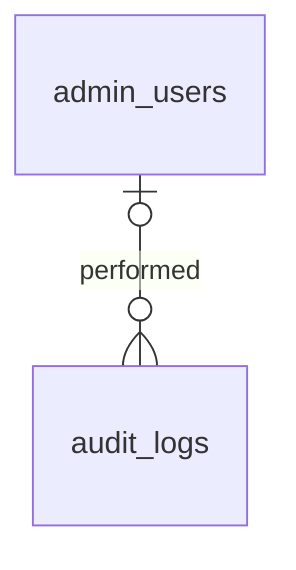
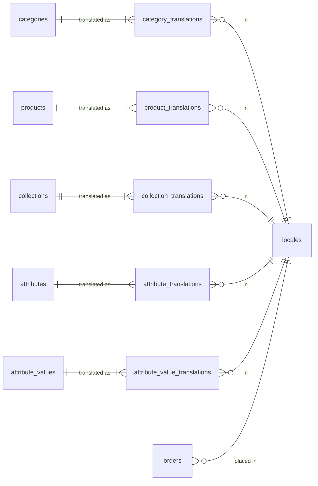

# Daisy Jewellery — PostgreSQL Database Architecture (simplified)

Status: **v3 — simplified + normalized translations** (implemented: `db/migrations/`) · Date: 2026-11-06
v3 change: localization moved from `_uk`/`_ru` column pairs to `locales` + per-entity `*_translations` tables with fallback to Ukrainian (§2a). Previous versions: git history.
Stack: Next.js · JavaScript · PostgreSQL · Knex.js (migration/query runner only; relationships are plain PostgreSQL FKs/constraints).
Principles: KISS, YAGNI. One shop, ~240 products, 2 languages today (more possible), 1 warehouse, guest checkout, a few admins.

**Result: 22 tables (16 core + `locales` + 5 translation tables) and 5 read views, down from ~55 in v1.** Rendered diagrams: `docs/database/er/`.

---

## 1. Source data in brief

Sources: DNTrade API (local `.next` cache sample: 233 website cards + 1,090 ring pieces), DNTrade CSV export `products_db_dump/` (236 website cards, one file per category: `Код`, `Назва`, `Зображ.`, `Артикул`, `Веб`, `Створення`), `i18n-export.csv` (ru strings).

Facts that shape the schema:

- **Website card** (`website_synch=1`) = what the customer sees; its `code` is in the URL (`/kabluchki/kupyty-sribnu-kabluchku/{code}`). → `products`.
- **Ring piece** (`website_synch=0`) = one physical ring with its own size, weight (in the title, `…#Каблучка срібна 1,25г`), price and `balance` 0/1. Sizes repeat (several 17s of different weight). Only rings have pieces. → `product_variants`.
- **SKU / `Артикул` is not a product key**: shared by up to 6 cards, across categories (`508-родовано` = bracelet + ring + 4 earrings), with whitespace/case variants (207 → 191). Stored as a plain, non-unique field.
- Category comes from the CSV file name (API `category` is null).
- Tags: `вставка` (23), `постачальник` (15, messy), `виробник` (7), `розмір`, `довжина`, `бейдж` (`знижка/10`, `новинка`, `популярне`).
- Import matching pieces → cards: 967 automatic, 41 ambiguous, 82 orphans → manual review list.

---

## 2. Key simplifications (v1 → v2)

| Area | v1 | v2 (KISS) | Why it is enough |
|---|---|---|---|
| Localization | `locales` + 7 `*_translations` tables | **v3:** `locales` + 5 `*_translations` tables (category, product, collection, attribute, attribute value); no language-specific columns. `*_i18n` views fall back to `uk` | Normalized; a new language = one `locales` row + translated rows, no migration. `media_translations` dropped (alt text = product title) |
| Variants & stock | `product_variants` + `variant_attribute_values` + `stock_units` + `inventory_levels` + `inventory_movements` + `warehouses` | **One `product_variants` table** = one sellable unit: optional size label + numeric size, optional weight, optional price override, optional stock qty, legacy ids | A ring piece is a variant (stock 0/1, own weight). A necklace is one variant (or one per length) with stock N. Customer picks a size; checkout reserves an in-stock variant of that size |
| Pricing | `price_lists` + `variant_prices` | `products.price`, `products.sale_price`; `product_variants.price` (override) and `cost_price` (internal, optional) | Retail + purchase are the only price types in use |
| Discounts | `discounts`, `discount_targets`, `order_discounts`, codes, redemptions | `products.sale_price` (crossed-out price). Order items snapshot the price paid | The only discount today is a per-product percent badge. Bulk sale = admin bulk-edit |
| Attributes / filters | 7 tables incl. per-category config and variant values | `attributes` → `attribute_values` → `product_attribute_values` (3 tables). Size, weight, price, stock filter on columns | Insertion, metal, coating, color, manufacturer stay dynamic and admin-editable. Filters shown for a category = attributes that have values there |
| Suppliers / manufacturers | `suppliers`, `manufacturers`, `product_suppliers` | `suppliers` + nullable `products.supplier_id`; manufacturer becomes an attribute | One supplier per product in practice; manufacturer is only displayed |
| Images | `media_assets`, `product_media`, `media_translations` | `product_images` (URL/path, sort order); alt text = product title | Images are never shared between products |
| Orders | orders + contacts + status history + shipments + shipment events + NP cache | `orders` (buyer, optional gift recipient, Nova Poshta refs + display text, TTN, status timestamps) + `order_items` | One delivery per order; recipient is at most one person |
| Payments | `payments` + `payment_events` + `refunds` | Same 2 tables kept; refunds = status on `payments` | Reliability + idempotency of LiqPay callbacks (see §5) |
| Admin | users, roles, user_roles, permissions, role_permissions, sessions, resets | `admin_users` with a `role` column (`owner` / `manager`) + `audit_logs` | 1–3 admins; permissions checked in code per role |
| Legacy IDs | `legacy_id_map` | Unique nullable legacy columns on `products`, `product_variants`, `suppliers`, `attribute_values` | Every legacy key belongs to exactly one table |

---

## 2a. Localization (v3)

- **`locales`** — `code` PK (`uk`, `ru`; format `xx` or `xx-XX`, CHECK), native `name`, `is_default`, `is_active`, `sort_order`. Partial UNIQUE index → at most one default; the default must be active. Seeded by the migration: `uk` (default), `ru`.
- **Translation tables** — one row per (entity, locale), same shape for all five:
  - PK `(<entity>_id, locale)` → one translation per entity and language.
  - `<entity>_id` FK → owner, `ON DELETE CASCADE`; `locale` FK → `locales.code`, `ON DELETE RESTRICT`, `ON UPDATE CASCADE` (a language in use can't be removed).
  - Slugs: UNIQUE `(locale, slug)` in `category_`, `product_`, `collection_translations`.
- **Non-translatable data stays on the owner**: codes, prices, status, sort order, legacy ids, `attribute_values.slug` (language-neutral URL-filter key), `suppliers.name` (internal).
- **Fallback to Ukrainian** — views `category_i18n`, `product_i18n`, `collection_i18n`, `attribute_i18n`, `attribute_value_i18n`: one row per (entity, locale in `locales`); each text field is `COALESCE(requested, default)`, so a missing Russian row — or a single empty Russian field — shows Ukrainian. `is_fallback = true` when no row exists for the requested locale (use it for `hreflang`/noindex decisions). Storefront reads `… FROM product_i18n WHERE locale = :locale`.
- **Rules (app/import)**: every entity gets a `uk` translation before it is set active; URL lookup by slug queries the translation table for the requested locale first, then the default one.
- **Adding a language** (e.g. `en`): `INSERT INTO locales` + translated rows. Until translated, the views serve Ukrainian.

| Table | Translated fields |
|---|---|
| `category_translations` | name, slug, url_prefix, description, seo_title, seo_description |
| `product_translations` | title, slug, short_description, description, seo_title, seo_description |
| `collection_translations` | name, slug, description |
| `attribute_translations` | name |
| `attribute_value_translations` | value |

---

## 3. Tables — keep / merge / remove

### 3.1 Final MVP tables (22)

| # | Table | Holds (key points, not full columns) |
|---|---|---|
| 1 | `categories` | Rings, earrings, necklaces, bracelets: `code` (unique), sort, active. Texts → `category_translations` |
| 2 | `products` | One website card / one URL. FK category, FK supplier (nullable). Legacy DNTrade GUID + `code` (unique). Article (non-unique). Texts → `product_translations`. `price`, `sale_price` (optional). Status (draft / active / archived). Original created date |
| 3 | `product_variants` | FK product. Sellable unit: size label + numeric size (optional; ring size or chain length), weight g (optional), price override + cost price (optional), stock qty (NULL = not tracked), legacy DNTrade GUID + `code` (unique), barcode. ≥1 per product |
| 4 | `product_images` | FK product, image path/URL, sort order; first = main |
| 5 | `collections` | «Клевер», «Новинки», «Популярне»…: `code` (unique), sort, active. Texts → `collection_translations` |
| 6 | `collection_products` | collection ↔ product (M:N) + position |
| 7 | `suppliers` | Name, contact (internal), legacy tag-item id. De-duplicated on import |
| 8 | `attributes` | Insertion, metal, coating, color, manufacturer…: code, filterable flag, sort. Name → `attribute_translations` |
| 9 | `attribute_values` | FK attribute; slug for URL filters (language-neutral), sort; legacy tag-item id. Label → `attribute_value_translations` |
| 10 | `product_attribute_values` | product ↔ attribute value (M:N, PK on the pair) |
| 11 | `orders` | Public number, guest access token, locale (FK `locales`), status + timestamps (paid/shipped/cancelled), payment method (card / COD), buyer name/phone/email/contact channel, optional gift recipient, Nova Poshta city ref/name + warehouse ref/name, TTN, delivery cost, totals, comment |
| 12 | `order_items` | FK order, FK variant (RESTRICT); snapshot: title, article, size, weight, unit price, original price, qty |
| 13 | `payments` | FK order; one row per LiqPay attempt: LiqPay `order_id` (unique), amount, currency, status, LiqPay payment id, paid/refunded timestamps |
| 14 | `payment_events` | FK payment; raw LiqPay callback/response (JSON), signature-valid flag, received at; unique idempotency key |
| 15 | `admin_users` | Email (unique), password hash, role (`owner` / `manager`), active, last login |
| 16 | `audit_logs` | Actor (admin user, nullable for system), action, entity type + id, before/after JSON, IP, time. Append-only |
| 17 | `locales` | Supported languages: code (PK), native name, default flag (one), active, sort |
| 18 | `category_translations` | category × locale (PK): name, slug, URL prefix, description, SEO |
| 19 | `product_translations` | product × locale (PK): title, slug, short + long description, SEO |
| 20 | `collection_translations` | collection × locale (PK): name, slug, description |
| 21 | `attribute_translations` | attribute × locale (PK): name |
| 22 | `attribute_value_translations` | attribute value × locale (PK): value |

### 3.2 Merged

| Removed table(s) | Merged into |
|---|---|
| `media_translations` | none — image alt text = translated product title |
| `stock_units`, `inventory_levels`, `variant_prices`, `variant_attribute_values` | `product_variants` columns |
| `price_lists` | `products.price` / `sale_price`, `product_variants.price` / `cost_price` |
| `manufacturers` | `attributes` (`manufacturer`) |
| `product_suppliers` | `products.supplier_id` |
| `media_assets`, `product_media` | `product_images` |
| `order_contacts`, `shipments`, `order_status_history` | `orders` columns (status changes by admins go to `audit_logs`) |
| `discounts`, `discount_targets`, `order_discounts` | `products.sale_price` + price snapshot on `order_items` |
| `roles`, `admin_user_roles`, `permissions`, `role_permissions` | `admin_users.role` |
| `legacy_id_map` | legacy columns on the owning tables |
| `refunds` | status / refunded timestamp on `payments` |

### 3.3 Removed (YAGNI) — add only when a real need appears

`warehouses`, `inventory_movements` (stock changes are traceable via `order_items` + `audit_logs`), `category_attributes`, `product_categories`, `related_products`, `catalog_search_index`, `url_redirects`, `customers`, `carts`, `cart_items`, `order_notes`, `shipment_events`, `np_cities`, `np_warehouses`, `discount_codes`, `discount_redemptions`, `admin_sessions` (signed cookie + `session_version` on `admin_users` for revocation), `admin_password_resets`, `purchase_orders`, `import_runs`, `outbox_events`.

---

## 4. ER diagrams

Relationships only. 4 domains. Rendered: `docs/database/er/er-0-overview` … `er-4-localization` (.mmd/.svg/.png) and `daisy-er-diagrams-v3.pdf`.

### 4.1 Catalog & filters

### 4.2 Orders, payments, delivery

Nova Poshta data (city/warehouse refs, display text, TTN) lives on `orders`; COD vs card is `orders.payment_method`.

### 4.3 Admin & audit

`audit_logs` references any entity by (type, id) without an FK.

### 4.4 Localization

Read with fallback through the `*_i18n` views (§2a).

---

## 5. Integrity rules (PostgreSQL, independent of Knex)

**Catalog**
- `products.legacy_code`, `products.legacy_id`, `product_variants.legacy_code`, `product_variants.legacy_id`: UNIQUE (nullable) → old URLs resolve by `code`.
- Translations: PK `(entity_id, locale)`; `locale` FK → `locales`; slugs UNIQUE per `(locale, slug)` (shop-wide, so category-scoped URLs also work). `locales`: one default (partial UNIQUE), code format CHECK.
- Prices `>= 0`; `sale_price < price` (CHECK); stock qty `>= 0` or NULL (CHECK); weight `> 0` or NULL.
- `product_attribute_values` PK (product, attribute value); `collection_products` PK (collection, product).
- Deleting a product cascades to translations, images, variants (only if never ordered), attribute links, collection links. Products with orders are **archived**, never deleted.

**Effective price** (app logic, one place): `variant.price ?? product.sale_price ?? product.price`. Sellable = product active, effective price present, stock NULL or > 0.

**Stock without a ledger**
- Reserve: `UPDATE product_variants SET stock_qty = stock_qty - :qty WHERE id = :id AND stock_qty >= :qty` inside the order-creation transaction; 0 rows → out of stock.
- Release on cancel / payment failure / unpaid timeout (scheduled job) in one transaction with the status change.

**Orders**
- `orders.number`, `orders.access_token`: UNIQUE. `order_items.variant_id` → `ON DELETE RESTRICT`. Totals stored and checked against items on write.
- Status as `text` + CHECK (`pending_payment`, `new`, `confirmed`, `shipped`, `delivered`, `cancelled`, `returned`) — no lookup table.

**LiqPay idempotency**
- `payments.liqpay_order_id` UNIQUE; one new attempt per retry.
- Partial UNIQUE index: at most one `payments` row with `status = 'success'` per order.
- `payment_events.idempotency_key` UNIQUE (LiqPay `payment_id` + `status`); callback flow: verify signature → `INSERT … ON CONFLICT DO NOTHING` → if inserted, update `payments`/`orders` in the same transaction. Duplicate callbacks become no-ops.
- Amount and currency in the callback must equal `payments.amount` before marking paid.

**Admin**
- `admin_users.email` UNIQUE (lower-cased); role CHECK (`owner`, `manager`). `audit_logs` append-only (app DB role has no UPDATE/DELETE on it).

---

## 6. MVP vs future

| MVP (launch) | Future — add when needed |
|---|---|
| 22 tables above, `uk` + `ru` | `discount_codes` (+ redemptions) for promo codes |
| CSV + API one-time import with review list | `customers` + accounts, wishlists |
| Existing `code` URLs | Slug URLs + `url_redirects` (301 from codes) |
| Filters: category, collection, attributes, size, price, in stock | `catalog_search_index` / `pg_trgm` search if queries slow down |
| Stock qty on variants with atomic reserve/release | `inventory_movements` ledger, `warehouses` if a 2nd location / accounting needs it |
| Nova Poshta fields on orders, live API autocomplete | `shipment_events` (tracking history), NP reference cache, multiple shipments |
| LiqPay payments + raw callbacks | Partial refunds table, other providers |
| Admin roles `owner` / `manager` + audit log | Fine-grained permissions, 2FA, server-side sessions |
| Sale price per product | Scheduled sales / category-wide rules (`discounts` table) |
| — | `related_products` ("complete the set"), `carts` (abandoned-cart emails); extra languages = `locales` row + translations, no schema change |

---

## 7. DNTrade → schema mapping

| DNTrade | Target |
|---|---|
| CSV file (category) + `Код`, `Артикул`, `Створення`, `Зображ.` | `products.category_id`, `legacy_code`, article, created date, first `product_images` row |
| Card `product_id`, title, descriptions, images, retail price | `products` (`legacy_id`, `price`), `product_translations` (`uk`), `product_images` |
| i18n `products.{category}.{code}.*` | `product_translations` (`ru`) |
| Ring piece `product_id`, `code`, barcode, `розмір`, weight from title, `balance`, `Закупка` | `product_variants` (one per piece; stock 0/1; `cost_price`) |
| Card without pieces + `довжина` / `розмір` / `balance` | one `product_variants` row (size label = length; stock = balance) |
| `вставка`, `виробник` (+ metal/coating parsed from titles) | `attribute_values` (+ `attribute_value_translations`) → `product_attribute_values` |
| `постачальник` | `suppliers` (de-duplicated) → `products.supplier_id` |
| `бейдж` `знижка/N` / `новинка`, `популярне` | `products.sale_price` / collections |

---

## 8. Implementation order

1. `admin_users`, `audit_logs`.
2. `locales` (seed `uk`, `ru`), `categories`, `suppliers`, `attributes`, `attribute_values` + their translation tables.
3. `products`, `product_translations`, `product_variants`, `product_images`, `product_attribute_values`, `collections`, `collection_translations`, `collection_products`; then the `*_i18n` fallback views.
4. Importer (dry-run → review list → final run); verify every existing URL by `code`.
5. Storefront reads from PostgreSQL (catalog, filters, size selector, search).
6. `orders`, `order_items`, `payments`, `payment_events`; replace Redis pending orders and DNTrade order upload.
7. Admin panel (catalog, stock, orders) with audit logging.
8. Switch off DNTrade after a short parallel run.

---

## 9. Decisions & open questions

**Decided:** DNTrade fully replaced; no richer CSV export exists (6-column card lists only); one URL per product, existing `code` URLs kept for now; single warehouse; v2 simplification adopted; **v3: normalized translation tables + `locales`, fallback to `uk`** (this document).

**Open**
- Price per model or per piece? Cards sell at ~1,200 грн, pieces carry 495–580 грн. v2 supports both (`products.price` + optional `product_variants.price`); import uses the card price until decided.
- Customer picks size only (assumed) or a specific piece by weight?
- 41 ambiguous and 82 orphan ring pieces (SKUs `508`, `759`, `765`, `779`, `2043р`; `1101.10р`, `1414.10р`…): new products or retired stock?
- 33 records with `balance = -1`: set stock to 0 on import?
- Category CSVs with the remaining data (sizes, prices, stock) — pending from owner; mapping in §7 will be checked against them.
